# Design System & Visual Identity: SIGNAL / SYNTAX

## 1. Creative Concept

**SIGNAL / SYNTAX** is an original developer identity crafted around **kinetic typography, precise spacing, and subtle system-inspired motion**.

Instead of decorative badges, illustration collages, or novelty receipts, this identity treats software engineering as an art of precision:
- **Signal**: The living transmission—an animated electric-blue signal trace drawing across the baseline.
- **Syntax**: The deterministic structure—geometric display typography paired with crisp monospaced metadata.

### Visual Personality
- **Typographic Wordmark**: `JASWANTH` rendered in bold, geometric letterforms with tracked proportions (`-0.02em` letter spacing).
- **Secondary Taxonomy**: `SOFTWARE ENGINEERING / AI SYSTEMS / PRODUCT EXPERIMENTS` in high-legibility monospace (`0.16em` letter spacing).
- **Structural Accents**: Corner crosshairs, category indicator (`SIGNAL // 01 · SYNTAX`), and baseline pulse node.
- **Telemetry-Free Focus**: Removed all arbitrary coordinates, fake telemetry, and decorative metrics to keep the engineering identity grounded and clear.
- **Restrained Palette**:
  - **Dark Mode** (`#0D1117` GitHub Canvas): `#F8FAFC` display letters (contrast ratio 18.09:1), `#38BDF8` electric sky-blue signal trace (contrast ratio 8.83:1), `#94A3B8` secondary microcopy.
  - **Light Mode** (`#FFFFFF` GitHub Canvas): `#0F172A` deep carbon letters (contrast ratio 17.85:1), `#0369A1` electric blue signal trace (contrast ratio 5.93:1), `#64748B` secondary microcopy.
  - Transparent SVG background for seamless integration across all themes.

---

## 2. Motion Design & Animation

The hero animation is a **one-time entrance sequence** lasting approximately **1.4 seconds**:
1. **Signal Trace** (`0.05s – 0.95s`): The fine baseline rule draws across from left to right using `stroke-dasharray` and `stroke-dashoffset` interpolation.
2. **Sequential Wordmark Reveal** (`0.10s – 0.65s`): Individual characters of `J A S W A N T H` reveal with a staggered vertical settling offset (`translateY(8px) -> translateY(0)`).
3. **Secondary Subtitle** (`0.85s – 1.45s`): The discipline classification resolves smoothly into position.
4. **Structural Geometry** (`1.10s – 1.40s`): Corner registration marks and header tags fade into place.

### Graceful Degradation & Motion Rules
- **No Infinite Loops**: Plays once; no bouncing, flashing cursors, or distracting loops.
- **`from`-Only Keyframes**: All keyframes are defined solely with `from { ... }`. The default, un-animated state of every SVG node is the completed, 100% visible design.
- **Accessibility**: `@media (prefers-reduced-motion: reduce)` immediately turns off all transitions and displays the final composition instantly.

---

## 3. GitHub Rendering Constraints & Limitations

GitHub processes SVGs referenced in Markdown via image tags (`` or `<picture>`). This imposes specific operational constraints:

1. **No JavaScript**: Scripts inside SVG are blocked by GitHub's content security policy. All animations are 100% pure CSS `@keyframes`.
2. **No Remote Web Fonts**: External font imports (`@import url(...)`) are blocked. The wordmark uses native system geometric font stacks (`-apple-system, BlinkMacSystemFont, 'Inter', 'Segoe UI', system-ui, sans-serif`) with system monospace fallbacks for metadata.
3. **Dual Theme Rendering via `<picture>`**:
   GitHub natively supports the HTML `<picture>` element with media queries in Markdown:
   ```html
   <picture>
     <source media="(prefers-color-scheme: dark)" srcset="assets/signal-wordmark-dark.svg">
     <source media="(prefers-color-scheme: light)" srcset="assets/signal-wordmark-light.svg">
     
   </picture>
   ```
   This guarantees that both GitHub Light and GitHub Dark display pixel-perfect colors, while `signal-wordmark.svg` provides the standalone fallback.

---

## 4. Content Architecture

1. **Hero Wordmark**: Kinetic typographic asset establishing identity and discipline taxonomy without arbitrary telemetry.
2. **Introduction & Current Focus**: Plain, credible statement of full-stack engineering, AI systems, and developer tooling; current focus grounded in active project architecture.
3. **Selected Work**: Three flagship systems (`MerchantOS`, `Memra`, `Barabari Collective`) demonstrating test coverage, deterministic isolation, and verified technical decisions.
4. **Professional Experience**: Three concise entries (`Xentro`, `Webbheads`, `Toji Labs`) highlighting shipped products, typed component architectures, client engagements, and revenue.
5. **Selected Recognition**: Verified differentiators (`JPMorgan Chase Code for Good 2026`, `IdeaSprint 3.0 Winner`, `AWS Student Builder Group at IIT Jodhpur`).
6. **More Work**: Compact references to additional public builds (`AI Visibility Score Tracker`, `CodeAtlas`, `CareLoop`, `OCR-to-Excel Pipeline`).
7. **Technical Toolkit**: Selective list of verified languages, runtimes, infrastructure tools, and AI engineering methodologies.
8. **Secondary Signal & Contact**: Understated note on algorithmic problem solving (250+ LeetCode) and campus community leadership; direct GitHub and LinkedIn links.
