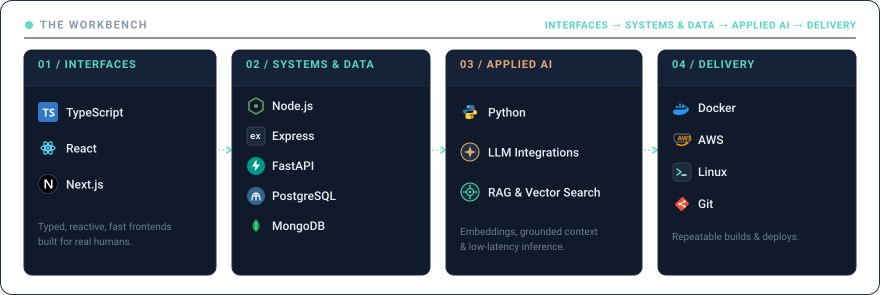

# Jaswanth Kumar Chettupalli

> You don't need everything figured out to build something that matters.

  <a href="https://github.com/CH-JASWANTH-KUMAR"><strong>GitHub</strong></a> &nbsp;&bull;&nbsp;
  <a href="https://www.linkedin.com/in/jaswanth-kumar-chettupalli-7b0809333/"><strong>LinkedIn</strong></a>

<picture>
  <source media="(prefers-color-scheme: dark)" srcset="./output.gif">
  <source media="(prefers-color-scheme: light)" srcset="./output.gif">
  
</picture>

---

### THE WORKBENCH

  

  <em>Curious about the whole journey &mdash; from the interface people see to the systems that make it work.</em>

---

  Still curious. Still building. Still figuring it out.

