<div align="center">



</div>

<details>
<summary>View Decision Record as plain text</summary>

```text
============================================
          DECISION RECORD
CANDIDATE: CHETTUPALLI JASWANTH KUMAR
GITHUB   : @CH-JASWANTH-KUMAR
TIMESTAMP: 2026-10-10
SHA      : local
--------------------------------------------
REQUEST:
Evaluate candidate for software engineering
internship.
--------------------------------------------
INPUTS (GitHub API, public data):
- 39 public repos (9 pushed in last 90d)
--------------------------------------------
RULES FIRED:
01 SEPARATE MATH FROM MODEL
   MerchantOS: 107 tests. TS calculates
   gross profit; LLM restricted to tools.
   Ref: MerchantOS decision-engine.service
02 KEEP USER DATA ON DEVICE
   Memra runs with no server database.
   11-page PDF compiled inside browser.
   Ref: github.com/CH-JASWANTH-KUMAR/memra
03 STATE OWN LIMITS HONESTLY
   MerchantOS price elasticity is a
   heuristic (0.5). Test Mode only.
   Ref: MerchantOS Sec 31 (System Limits)
04 CREDIT UPSTREAM AUTHORS
   CodeAtlas upstream by Manish Kumar.
   Jaswanth built Groq assistant (fb4cf19,
   866 additions across 3 added files).
05 TEST DETERMINISTICALLY BEFORE LIVE
   CareLoop has 31 passing assertions
   across 3 suites before sandbox run.
   Ref: careloop/scripts (Phase 3, 4, 6)
--------------------------------------------
DECISION:

        [ WORTH A CONVERSATION ]

Basis    : 3 flagship builds, 107 tests
Overrides: None
LinkedIn : linkedin.com/in/
  jaswanth-kumar-chettupalli-7b0809333/
============================================
```

</details>

---

## What I'm building

Most of what I build puts an LLM inside rules I can test. Plain code does the math and the checks, and the model does the language.

---

## Projects

### [Memra](https://github.com/CH-JASWANTH-KUMAR/memra)
Converts WhatsApp chat exports into a private, 11-page memory book entirely inside the browser.
* **Hard Fact**: Runs with no server database; all message parsing, authenticity filtering, and PDF generation execute client-side via `jsPDF`.
* **Honest Limit**: Narrative generation requires an external Groq API key (a deterministic local template fallback executes if unset); physical print binding remains on the roadmap.

### [MerchantOS](https://github.com/CH-JASWANTH-KUMAR/MerchantOS)
Autonomous revenue decision engine for digital commerce merchants that pairs association rule mining with bounded discount optimization.
* **Hard Fact**: 107 passing automated tests across the monorepo; financial profit calculations are computed strictly by TypeScript math services rather than the language model.
* **Honest Limit**: Price elasticity is modeled with a heuristic factor (0.5) rather than causal econometric inference; commercial actions execute strictly in Razorpay Test Mode.

### [AI Visibility Score Tracker](https://github.com/CH-JASWANTH-KUMAR/AI-VISIBILITY-SCORE)
Measures brand presence and competitor ranking across parallel AI models for industry-specific search queries.
* **Hard Fact**: Evaluates 50–100 deduplicated queries across 4 models simultaneously and scores visibility using a 4-factor formula (40% mention rate, 30% rank score, 20% competitor dominance, 10% model consistency).
* **Honest Limit**: Requires active API keys across all 4 commercial model providers; historical trend tracking is planned for v2.

---

## Also built

* **[CodeAtlas](https://github.com/CH-JASWANTH-KUMAR/CODEATLAS)** — Upstream repository intelligence tool created by Manish Kumar; I built the Groq-powered interactive repository assistant layer (commit `fb4cf19`, 866 additions across 3 added files) and decoupled the Prisma dependency for standalone demo execution.
* **[ResearchLens](https://github.com/CH-JASWANTH-KUMAR/naccer-rd-evaluation-copilot)** — Problem statement copilot for NaCCER/CMPDI R&D grant review; validates budget arithmetic, applies 0–10 rubrics, and flags reviewer score divergence (>= 2.0 points).
* **[CareLoop](https://github.com/CH-JASWANTH-KUMAR/careloop)** — Team build for The Ken case-build; I built the frontend command center and 31 deterministic tests.
* **[OCR-to-Excel Pipeline](https://github.com/CH-JASWANTH-KUMAR/OCR-TO-EXCEL-PIPELINE)** — Dual-stage document extraction pipeline combining OpenCV preprocessing, PaddleOCR, and OpenRouter LLM schema normalization with automated `NEEDS_REVIEW` confidence scoring.

---

## Stack

* **Languages**: TypeScript, Python, JavaScript
* **Frontend & Runtimes**: Next.js (App Router), React, Node.js, Tailwind CSS
* **Backend & Systems**: FastAPI, Express, PostgreSQL, MongoDB, Docker
* **Machine Learning & NLP**: scikit-learn, mlxtend, spaCy, OpenCV, PaddleOCR
* **Model Integrations**: Google Gemini, Groq (Llama 3.3 70B), Anthropic Claude, OpenAI

---

## Contact

* **LinkedIn**: [linkedin.com/in/jaswanth-kumar-chettupalli](https://www.linkedin.com/in/jaswanth-kumar-chettupalli-7b0809333/)
* **GitHub**: [@CH-JASWANTH-KUMAR](https://github.com/CH-JASWANTH-KUMAR)

---

This page is generated by [tools/build.py](tools/build.py) from [facts.json](facts.json).
