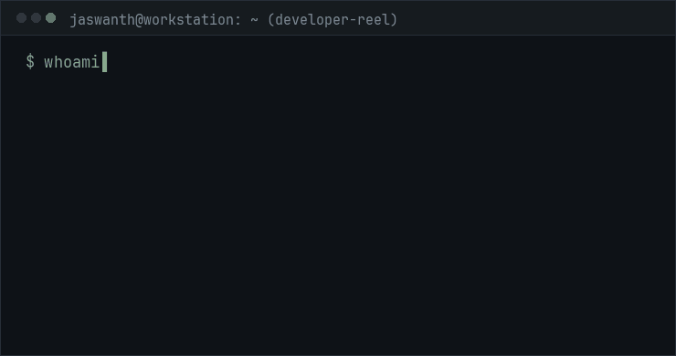

> Software gets interesting when it stops being a demo and starts being dependable.

[GitHub](https://github.com/CH-JASWANTH-KUMAR) &nbsp;·&nbsp; [LinkedIn](https://www.linkedin.com/in/jaswanth-kumar-chettupalli-7b0809333/)

  

